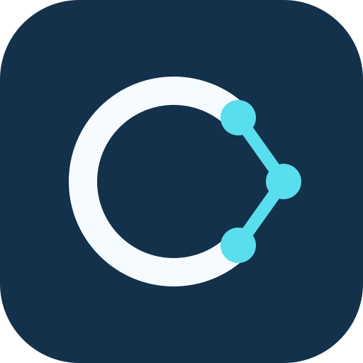

# CleanNetwork plugin for Codex and Claude Code



An installable, instruction-only plugin for integrating iOSCleanNetwork and
AndroidCleanNetwork in a consuming app or SDK. It packages the released guides,
executable examples and tests; it does not install a networking dependency or
connect to a service.

| Included skill | Purpose | SDK baseline |
| --- | --- | --- |
| `cleannetwork` | Identify the platform and fit the workflow to the consumer | Both |
| `ioscleannetwork` | Swift endpoint integration, mapping and tests | 1.0.4 |
| `androidcleannetwork` | Kotlin/Android endpoint integration, mapping and tests | 1.0.1 |

Plugin version **0.3.0** is independent of the two SDK versions. The platform
guides and examples are copied unchanged from pinned upstream Git commits.
Both clients share these sources. The Claude account upload adapts a few example
file paths to its upload limits, as described below.

## Install from GitHub

The public marketplace is **alegelos/CleanNetworkPlugin**. In Codex:

```sh
codex plugin marketplace add alegelos/CleanNetworkPlugin
codex plugin add cleannetwork@cleannetwork-tools
```

In Claude Code:

```sh
claude plugin marketplace add alegelos/CleanNetworkPlugin
claude plugin install cleannetwork@cleannetwork-tools --scope user
```

Start a new session in the app or SDK that consumes CleanNetwork. Invoke
`$cleannetwork:cleannetwork` in Codex or `/cleannetwork:cleannetwork` in Claude Code.
The plugin selects the platform guide, inspects the resolved SDK version and
adapts to your existing architecture.

Download versioned ZIPs from [GitHub Releases](https://github.com/alegelos/CleanNetworkPlugin/releases).
GitHub distribution is separate from an official directory listing. Until a
directory submission is approved and published, install through this marketplace
or a release ZIP. [Directory submission details](docs/PUBLISHING.md).

## Install from the Claude application

In Claude Desktop or on the web, open **Customize → Plugins** and use the custom
plugin upload option. Select `cleannetwork-claude-0.3.0.zip` from `dist/`, keeping
it zipped. Use this upload archive, not the marketplace archive. Plugins added
there belong to your Claude account. Claude Code **2.1.273+**, signed in with the
same account, syncs them at startup; API-key sessions do not sync account plugins.
See [Claude's installation and sync instructions](https://support.claude.com/en/articles/13837440-use-plugins-in-claude).

Alternatively, install locally in Claude Code with the marketplace below. In a
local or SSH session in the desktop app's **Code** tab, its plugin browser is
under **+ → Add plugins** (or **+ → Plugins → Browse plugins**). After registering
this marketplace, select CleanNetwork and the user/project/local scope. Cloud
sessions have a different setup: they do not load plugins installed on your Mac.
See [Claude Code's desktop installation instructions](https://code.claude.com/docs/en/plugins/install).

## Install locally in Claude Code

Register this checkout or the extracted `cleannetwork-marketplace-0.3.0.zip`:

```sh
claude plugin marketplace add /path/to/CleanNetworkPlugin
claude plugin install cleannetwork@cleannetwork-tools --scope user
claude plugin list --json
claude plugin details cleannetwork@cleannetwork-tools
```

Keep the extracted marketplace available at that location, including its hidden
`.claude-plugin/` directory. The in-session equivalents are `/plugin marketplace
add /path/to/CleanNetworkPlugin` and `/plugin install cleannetwork@cleannetwork-tools`;
the latter opens a details panel where you complete installation. Start a new
session in your consumer project after a CLI install.

Invoke `/cleannetwork:cleannetwork`, `/cleannetwork:ioscleannetwork` or
`/cleannetwork:androidcleannetwork`. For example:

```text
/cleannetwork:cleannetwork Identify the SDK and resolved version in this app,
then implement GET /users/{id} using the supplied API contract and JSON.
Keep our existing target/module layout and add relevant tests.
```

Choose either the account upload or the local marketplace installation to avoid
duplicate copies of the same skills. Installing the SwiftPM/Gradle dependency
by itself does not install this plugin.

## Install in Codex

Use a Codex CLI that supports `codex plugin` (check `codex plugin --help`). From
any directory, register this marketplace and install its plugin:

```sh
codex plugin marketplace add /path/to/CleanNetworkPlugin
codex plugin add cleannetwork@cleannetwork-tools
codex plugin list --marketplace cleannetwork-tools --json
```

Replace the path with this checkout, or the directory where you extracted
`cleannetwork-marketplace-0.3.0.zip`. Keep the entire extracted marketplace,
including `.agents/` and `plugins/`, together and available at that path.

Start a new Codex session in the **consumer app/SDK**. In Codex in the ChatGPT
desktop app, restart the app if the new marketplace is not visible, then select
CleanNetwork in Plugins. Codex CLI also exposes the `/plugins` browser.

Select the CleanNetwork skill for platform selection, or the iOSCleanNetwork /
AndroidCleanNetwork skill for an endpoint integration. The same skills can also
be selected automatically when their descriptions match. If you already installed
a standalone copy, choose the plugin's copy explicitly or remove the duplicate
after reviewing any local customizations.

Codex exposes plugin skills with a namespace. Explicit mentions are
`$cleannetwork:cleannetwork`, `$cleannetwork:ioscleannetwork` and
`$cleannetwork:androidcleannetwork`. Select the matching entry in the skill picker
if your client uses a different mention interface.

Example request:

```text
$cleannetwork:cleannetwork Identify the SDK in this app and its installed
version, then implement GET /users/{id} using the supplied API contract and JSON.
Keep our existing target/module layout and add relevant tests.
```

Provide the real endpoint contract and representative JSON. The bundled examples
use fictional User/Item features and example.com URLs. Domain and Data can be
folders in a single target/module or separate modules. Presenter/ViewModel is
used when the requested feature needs presentation; an SDK without UI does not
need a new presentation layer.

Installing this plugin does not update SwiftPM/Gradle dependencies, change the
consumer's architecture or grant GitHub access. The iOS and Android guides live
inside their skills and remain the technical source of truth.

## Distribution and updates

`python3 scripts/build_plugin.py` produces three archives in `dist/`:

- `cleannetwork-0.3.0.zip`: the plugin root with both client manifests.
- `cleannetwork-marketplace-0.3.0.zip`: a complete local marketplace for both
  clients, including maintenance/verification scripts.
- `cleannetwork-claude-0.3.0.zip`: a Claude account upload with only the Claude
  manifest and paths adapted to the account upload limits.
- `SHA256SUMS.txt`: checksums of all three archives.

The upload archive removes `+` from one Swift fixture filename, adjusts its guide
link, and shortens the Kotlin source paths while preserving package declarations.
It retains complete runnable examples. Its `upload-layout.json` records the
projection and file hashes; `sources.lock.json` describes the canonical upstream
files. The repository, local marketplace and Codex archive keep the original
paths and bytes. These transformations follow the
[Claude upload requirements](https://platform.claude.com/docs/en/manage-claude/plugins-api#upload-requirements).

These archives are published on GitHub Releases. The repository and its
marketplace are publicly installable; this does not by itself create a listing
in OpenAI's or Anthropic's public plugin directory.

To update a local installation, replace the extracted marketplace with the new
version and run `codex plugin add cleannetwork@cleannetwork-tools` again, then
start a new session. For a Git-backed marketplace, refresh the source first with
`codex plugin marketplace upgrade cleannetwork-tools`. Check the version reported
by `codex plugin list`; updating the catalog and installing the plugin are
separate steps. Do not assume that publishing an SDK release updates this bundle.

To remove it:

```sh
codex plugin remove cleannetwork@cleannetwork-tools
codex plugin marketplace remove cleannetwork-tools
```

For a local Claude marketplace, replace the extracted files, run
`claude plugin marketplace update cleannetwork-tools`, then
`claude plugin update cleannetwork@cleannetwork-tools --scope user`. Start a new
session and verify the version with `claude plugin list --json`. Remove with
`claude plugin uninstall cleannetwork@cleannetwork-tools --scope user` and
`claude plugin marketplace remove cleannetwork-tools`.
For an account upload, upload the next Claude ZIP through the same account UI.

Copilot can use the standalone SDK skills through its own installation flow;
this repository does not establish Copilot plugin compatibility.

## Maintain the bundle

Requires Python 3.9+, Git and compatible Codex/Claude Code CLIs for verification.
Read [AGENTS.md](AGENTS.md) for the working contract. The source releases, Git
commits and per-file SHA-256 hashes are in
[`sources.lock.json`](plugins/cleannetwork/sources.lock.json).

To refresh from the pinned releases, using local SDK checkouts that contain the
listed tags and commits:

```sh
python3 scripts/sync_skills.py \
  --ios-checkout ../iOSCleanNetwork \
  --android-checkout ../AndroidCleanNetwork
python3 scripts/validate_plugin.py
python3 -m unittest discover -s tests -v
python3 scripts/build_plugin.py
python3 scripts/verify_codex.py --work-dir .unlazy/codex-verification
python3 scripts/verify_claude.py --work-dir .unlazy/claude-verification
```

Sync reads committed Git objects, excludes untracked build output by construction
and refuses to overwrite locally modified bundled skills. For an SDK update,
review upstream first, change the corresponding tag/commit in the lock while
keeping the previous file hashes, then sync. Update the router baselines and this
README, bump the version in both plugin manifests, review the upload projection,
validate and rebuild. Do not edit the copied platform guides independently.

Both client checks use isolated configuration directories, install from extracted
archives, verify skill discovery through the real CLI and keep receipts. They
also exercise update/removal. Neither installs into your personal profile or
calls a model/API. `verify_claude.py --claude-bin /path/to/claude` can select a
specific CLI. The Claude check validates the upload ZIP locally; it does not
upload to your account or prove server acceptance or account synchronization.

Verified with Claude Code 2.1.322 and Codex 0.165.0-alpha.1.2. Desktop instructions
were checked against official documentation; no desktop UI installation was
performed. Whenever the upload projection changes, run both extracted consumer
examples using the SDKs' documented verification commands.

Official references: [plugin packaging](https://developers.openai.com/plugins/build/plugins),
[Codex commands](https://learn.chatgpt.com/docs/developer-commands),
[plugin availability](https://learn.chatgpt.com/docs/plugins).

MIT. See [LICENSE](LICENSE). The plugin carries the upstream SDK license with
the copied guides/examples and preserves the Gradle wrapper's embedded notices.
