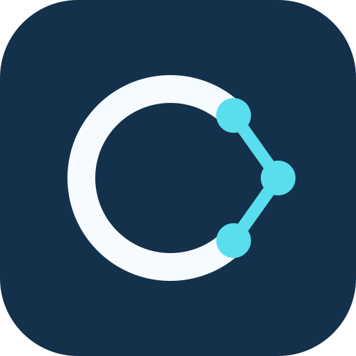

# CleanNetwork



Use the bundled skills to integrate iOSCleanNetwork or AndroidCleanNetwork in
your app or SDK. The guides cover endpoint setup, request and response mapping,
fictional fixtures, and tests. They preserve the project's existing targets or
modules; presentation is optional for an SDK without UI.

In Claude Code, invoke `/cleannetwork:cleannetwork` to select the right platform,
or `/cleannetwork:ioscleannetwork` or `/cleannetwork:androidcleannetwork` directly.
In Codex, use the corresponding `$cleannetwork:cleannetwork`,
`$cleannetwork:ioscleannetwork` or `$cleannetwork:androidcleannetwork` skill.
Include your endpoint contract and representative JSON in the request.

Install from the public marketplace:

```sh
claude plugin install cleannetwork --marketplace alegelos/CleanNetworkPlugin
```

For Codex, add `alegelos/CleanNetworkPlugin` with `codex plugin marketplace add`,
then install `cleannetwork@cleannetwork-tools` with `codex plugin add`.

The plugin contains instructions, examples and tests. It does not install SDK
dependencies, change your architecture or connect to external services. The
SDK guide baselines are iOS 1.0.4 and Android 1.0.1; check your resolved SDK version
before generating an integration.

Installing the plugin loads its instructions and files. Running an example's
build commands downloads public development dependencies from the sources in
its SwiftPM or Gradle build files. The Android example includes the upstream
Gradle wrapper JAR and its embedded license. Fixture tests use fictional data;
they do not call a production API.

Start with the [platform selection skill](skills/cleannetwork/SKILL.md). Technical
guidance lives in the [Swift guide](skills/ioscleannetwork/references/integration.md)
and [Android guide](skills/androidcleannetwork/references/integration.md).

Report problems or request help through the
[project's issues](https://github.com/alegelos/CleanNetworkPlugin/issues).
